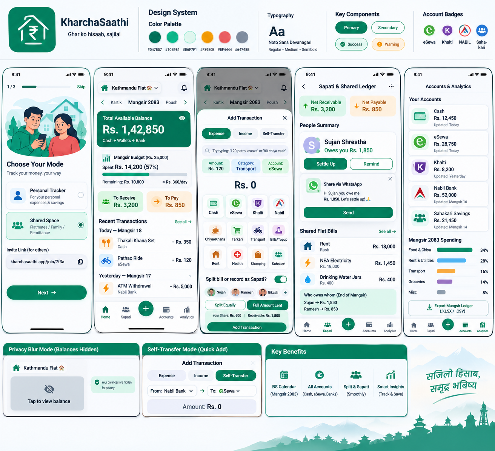

# KharchaSaathi (खर्चसाथी) — Ghar ko hisab, sajilai
**Offline-First Personal Finance, Peer Lending (*Sapati*), and Bikram Sambat Ledger Progressive Web App**

📄 **[Read the Full Technical Architecture & Engineering Review Report (PDF)](./docs/KharchaSaathi_Technical_Review_Report.pdf)**

---


## Overview

**KharchaSaathi** is a mobile-first personal and shared household (*Ghar ko Hisab*) expense manager built specifically for the Nepali financial ecosystem. Unlike generic global expense trackers, it models Nepali digital wallets and cooperatives alongside cash and bank accounts, splits shared bills into peer-to-peer *Sapati* ledgers without inflating personal spending, and organizes monthly insights by the official **Bikram Sambat (BS)** calendar.

### Key Features
* **Multi-Account & Wallet Liquidity:** Manage **Cash in Hand**, **eSewa / Khalti**, **Commercial Banks**, and **Sahakari (Cooperatives)** with atomic balance updates.
* **Self-Transfers:** Move funds between your own accounts (e.g., Bank → eSewa load or ATM cash withdrawal) without counting transfers as income or expense.
* **Quick Expense & *Sapati* Splitting:** Log expenses in seconds and split bills with friends (*They Owe Me* / *I Owe Them*), keeping your true personal share separate from recoverable receivables.
* **One-Tap *Sapati* Settlement:** Settle pending receivables or payables directly into or from any chosen wallet/account.
* **Bikram Sambat (BS) Monthly Insights:** Automatic AD-to-BS date conversion on the backend with month-by-month BS filtering (*Baisakh* to *Chaitra*) and category spending caps.
* **Shared Household (*Ghar ko Hisab*) & Privacy Mode:** Switch between Personal and Shared workspaces, copy workspace invite codes, and blur sensitive NPR amounts in public.
* **Offline-First PWA with Auto-Sync:** Powered by IndexedDB (Dexie) and client-generated UUID idempotency keys so offline expenses queue locally and flush automatically when connectivity returns.

---

## Tech Stack

| Layer | Technologies |
| :--- | :--- |
| **Backend API** | Python 3, Django, Django REST Framework (DRF) |
| **Database** | PostgreSQL (`transaction.atomic()`, `select_for_update()` row locking) |
| **Authentication** | JWT (`django-simplejwt`) with automatic Axios 401 refresh queuing |
| **Nepali Calendar** | `nepali-datetime` (AD to Bikram Sambat conversion) |
| **Frontend PWA** | React, Vite, Tailwind CSS, Lucide Icons, Axios, Dexie.js (IndexedDB) |
| **Target Packaging** | Installable PWA & Android App Bundle (`.aab`) via Trusted Web Activity (TWA) |

---

## Repository Structure

```text
kharchasaathi/
├── backend/
│   ├── core/
│   │   ├── models.py          # Workspace, Account, Transaction, SapatiSplit, Contact, Category
│   │   ├── serializers.py     # Nested Transaction & SapatiSplit serializers
│   │   ├── services.py        # FinancialService (ACID ledger, locking, BS conversion)
│   │   ├── views.py           # ViewSets, settle action, BS dashboard summary
│   │   └── urls.py            # /api/v1/ router endpoints
│   └── manage.py
├── frontend/
│   ├── src/
│   │   ├── components/
│   │   │   ├── QuickAddModal.jsx   # Fast expense & Sapati split bottom sheet
│   │   │   ├── SapatiTab.jsx       # Pending & settled peer lending ledger
│   │   │   ├── AccountsTab.jsx     # Wallet cards, bucket creation & self-transfers
│   │   │   └── BsInsightsCard.jsx  # Bikram Sambat monthly category breakdown
│   │   ├── db/
│   │   │   └── offlineStore.js     # Dexie IndexedDB schema & syncQueue
│   │   ├── services/
│   │   │   └── api.js              # Axios client, JWT refresh interceptor & offline fallback
│   │   └── App.jsx                 # Workspace switcher, offline banner & navigation shell
│   └── package.json
└── docs/
    └── KharchaSaathi_Technical_Review_Report.pdf
```

---

## Local Development Setup

### 1. Backend (Django + PostgreSQL)

```bash
cd backend
python -m venv venv
# Windows: venv\Scripts\activate | macOS/Linux: source venv/bin/activate
pip install -r requirements.txt
python manage.py migrate
python manage.py runserver
```
The API will be available at `http://127.0.0.1:8000/api/v1/`.

### 2. Frontend (React + Vite PWA)

```bash
cd frontend
npm install
npm run dev
```
The frontend will be available at `http://localhost:5173`.

---

## Core API Endpoints (`/api/v1/`)

| Method | Endpoint | Description |
| :--- | :--- | :--- |
| `POST` | `/auth/register/` | Register user & auto-provision default workspace + Cash/eSewa accounts |
| `POST` | `/auth/login/` | Obtain JWT `access` and `refresh` tokens |
| `POST` | `/auth/token/refresh/` | Refresh expired JWT access token |
| `GET / POST` | `/workspaces/` | List user workspaces or create a Personal / Shared workspace |
| `GET / POST` | `/accounts/` | List workspace accounts or create a new liquidity bucket |
| `GET / POST` | `/transactions/` | Query by `workspace`, `bs_year`, `bs_month` or create atomic transactions/splits |
| `GET` | `/sapati/` | List `RECEIVABLE` and `PAYABLE` Sapati splits |
| `POST` | `/sapati/<id>/settle/` | Atomically mark a Sapati split settled and update target wallet balance |
| `GET` | `/dashboard/` | Fetch total balance, BS monthly personal spend, and pending Sapati totals |

---

## Security & Data Integrity Highlights

* **ACID Ledger Operations:** All balance mutations (`EXPENSE`, `INCOME`, `TRANSFER`, and `Sapati` settlements) run inside `transaction.atomic()` with `select_for_update()` row-level locks to prevent race conditions.
* **Idempotent Offline Replay:** Offline transactions carry client-generated UUID `idempotency_key` values so background sync retries never create duplicate ledger entries.
* **Single-Flight JWT Refresh:** Concurrent API requests encountering `401 Unauthorized` are queued while a single refresh call renews the access token.

---

## Roadmap to Play Store (TWA)

- [x] Core ACID ledger, multi-account transfers, *Sapati* splitting & settlement, BS monthly insights, offline sync queue, and workspace switcher
- [ ] Enforce `IsWorkspaceMember` object-level DRF permissions & workspace invite-code join endpoint
- [ ] Extend offline `syncQueue` support to *Sapati* settlements and contact creation
- [ ] Automated test suite (`pytest-django` & Vitest) for concurrency locks, BS edge dates, and offline replay
- [ ] HTTPS production deployment + Bubblewrap Trusted Web Activity (`.aab`) packaging & Digital Asset Links (`assetlinks.json`)